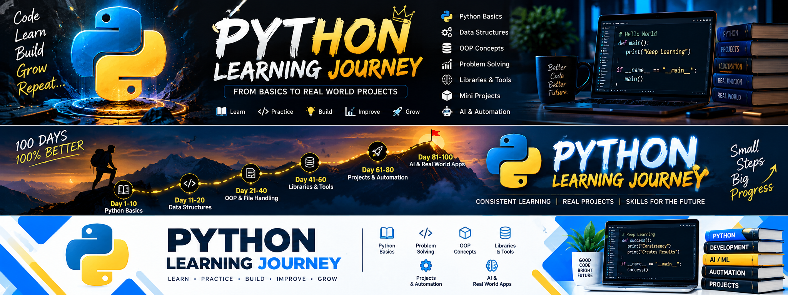
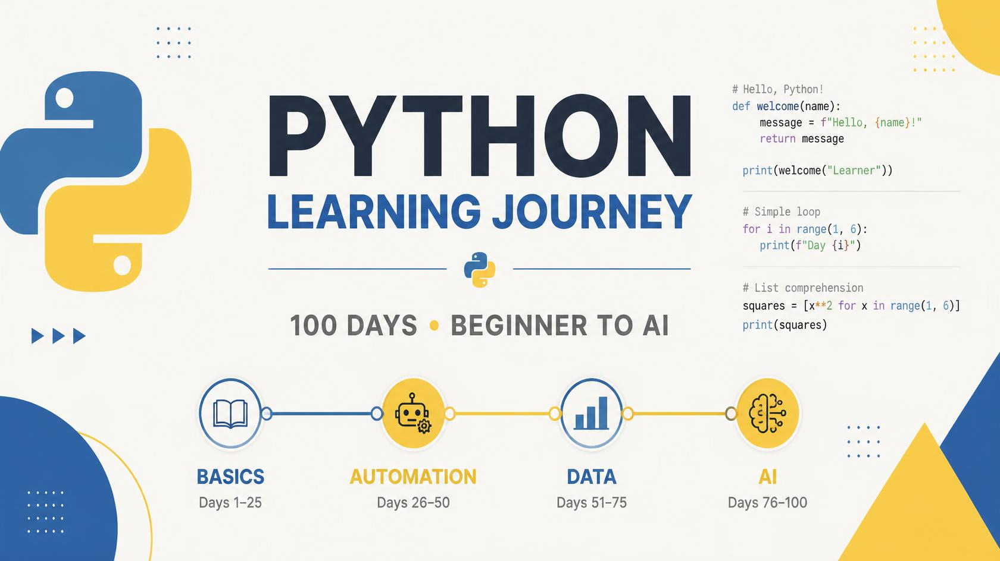
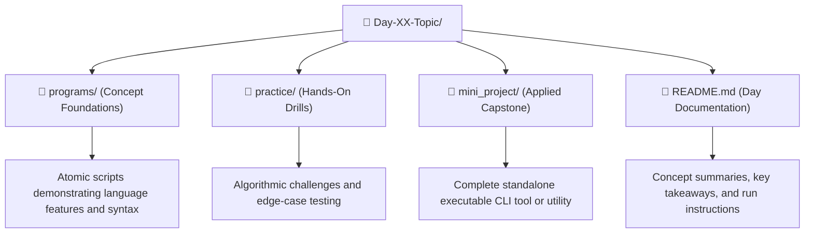
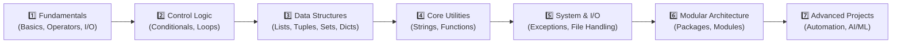
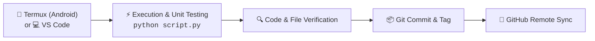
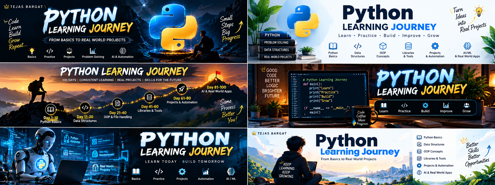

<p align="center">
  
</p>

# 🐍 Python Learning Journey

<p align="center">
  <strong>From Syntax to Systems: A Day-by-Day Hands-on Python Mastery Journey</strong><br>
  <em>Practice Programs • Algorithmic Challenges • Real-World Mini Projects • Architecture Notes</em>
</p>

<p align="center">
  <a href="https://www.python.org/"></a>
  <a href="https://termux.dev/"></a>
  <a href="https://github.com/tejasbargat16-ux/Python-Learning-Journey"></a>
  <a href="https://github.com/tejasbargat16-ux/Python-Learning-Journey/stargazers"></a>
</p>

---

## 🎯 Purpose & Goals

This repository documents my structured roadmap to mastering Python from scratch to advanced production-level applications:
- **Rock-Solid Core**: Deep understanding of variables, control flow, data structures, and OOP.
- **Architectural Discipline**: Strict separation of conceptual theory, deliberate practice, and real-world mini projects.
- **Real-World Applications**: Building practical CLI tools, file management systems, data processing scripts, and automation utilities.
- **Future Ready**: Laying a solid engineering foundation for **AI/ML**, **IoT**, and **Embedded Systems**.

---

## 🗺️ 100 Days Roadmap

<p align="center">
  
</p>

The journey is structured across four comprehensive milestones:

| Phase | Milestone | Focus Areas |
|:---:|:---|:---|
| **Phase 1** | **Basics & Core (Days 1–25)** | Syntax, operators, conditionals, loops, functions, data structures, file I/O & exception handling |
| **Phase 2** | **Automation & Tooling (Days 26–50)** | OS interactions, regular expressions, web scraping, CLI automation & package architectures |
| **Phase 3** | **Data & Analytics (Days 51–75)** | NumPy, Pandas, data wrangling, APIs, and statistical computing |
| **Phase 4** | **AI & Machine Learning (Days 76–100)** | Predictive modeling, computer vision, neural networks & capstone projects |

---

## 🏗️ Architecture & Design System

The repository follows a uniform **3-Tier Module Pattern** for every single day to ensure consistent learning, code readability, and testability.

### 1. Day Module Structure (3-Tier Pattern)



### 2. Learning Progression Flow



### 3. Development & Deployment Pipeline

Code is written and verified in both mobile Termux environments and desktop VS Code environments before committing to GitHub:



### 4. Repository Structure

<!-- STRUCTURE:START -->
```text
Python-Learning-Journey/
├── .github/                                     # Automated workflows & CI/CD
│   └── workflows/
│       └── update-readme.yml                    # Automated GitHub Actions tracker workflow
├── assets/                                      # Banners, roadmaps, and visual documentation
│   ├── banner-code-to-creation.png
│   ├── banner-roadmap.jpg
│   └── banner-collection.png
├── scripts/                                     # Automation scripts
│   └── update_readme.py                         # Automation script to rebuild progress table
├── Day-01-Python-Basics/                        # Variables, data types & type casting
├── Day-02-Operators/                            # Arithmetic, logical & comparison operators
├── Day-03-Conditional-Statements/               # If/elif/else decision control
├── Day-04-Loops/                                # For, while loops & loop control statements
├── Day-05-Functions/                            # Functions, arguments, return values & scope
├── Day-06-Lists/                                # Dynamic arrays, list operations & indexing
├── Day-07-Tuples/                               # Immutable sequences & tuple unpacking
├── Day-08-Sets/                                 # Unique collections & set operations
├── Day-09-Dictionaries/                         # Key-value mapping & hash tables
├── Day-10-Strings/                              # String manipulation, slicing & formatting
├── Day-11-Exception-Handling/                   # Robust error management & input validation
├── Day-12-File-Handling/                        # Persistent file I/O & record storage
├── Day-13-Modules-Packages/                     # Custom & built-in modules, namespaces & CLI
├── Day-14-OOP/                                  # Classes, objects, constructors & methods
├── Day-15-OOP/                                  # Day-15-OOP
└── README.md                                    # Master repository documentation
```
<!-- STRUCTURE:END -->

---

## 📈 Progress Tracker

<!-- PROGRESS:START -->
| Day | Topic | Programs | Status |
|:---:|:---|:---:|:---:|
| 01 | [Python Basics](Day-01-Python-Basics/) | 10 | ✅ |
| 02 | [Operators](Day-02-Operators/) | 12 | ✅ |
| 03 | [Conditional Statements](Day-03-Conditional-Statements/) | 13 | ✅ |
| 04 | [Loops](Day-04-Loops/) | 12 | ✅ |
| 05 | [Functions](Day-05-Functions/) | 13 | ✅ |
| 06 | [Lists](Day-06-Lists/) | 2 | ✅ |
| 07 | [Tuples](Day-07-Tuples/) | 12 | ✅ |
| 08 | [Sets](Day-08-Sets/) | 15 | ✅ |
| 09 | [Dictionaries](Day-09-Dictionaries/) | 14 | ✅ |
| 10 | [Strings](Day-10-Strings/) | 17 | ✅ |
| 11 | [Exception Handling](Day-11-Exception-Handling/) | 15 | ✅ |
| 12 | [File Handling](Day-12-File-Handling/) | 16 | ✅ |
| 13 | [Modules & Packages](Day-13-Modules-Packages/) | 18 | ✅ |
| 14 | [Object-Oriented Programming (OOP)](Day-14-OOP/) | 10 | ✅ |
| 15 | [Object-Oriented Programming (OOP)](Day-15-OOP/) | 10 | ✅ |

**Total days completed: 15**
<!-- PROGRESS:END -->

---

## 🎨 Visual Showcase & Banners

<details>
<summary><strong>🔍 Click to view the Banner Collection Showcase</strong></summary>
<br>

<p align="center">
  
</p>

</details>

---

## 🚀 How to Run

### 1. Clone the Repository
```bash
git clone https://github.com/tejasbargat16-ux/Python-Learning-Journey.git
cd Python-Learning-Journey
```

### 2. Run Any Program or Mini Project
```bash
# Example 1: Run Day 14 Student Profile Manager
python Day-14-OOP/mini_project/main.py

# Example 2: Run Day 13 Smart Utility Toolkit
python Day-13-Modules-Packages/mini_project/main.py

# Example 3: Run Day 12 Student Record Manager
python Day-12-File-Handling/mini_project/student_record_manager.py
```

### 3. Termux Setup (Android Users)
```bash
pkg update && pkg upgrade -y
pkg install python git -y
```

---

## 🛠️ Tech Stack & Environment

| Component | Tool / Technology |
|:---|:---|
| **Language** | Python 3.10+ |
| **Development Environments** | Termux (Android Mobile), Visual Studio Code (Desktop) |
| **Version Control** | Git & GitHub |
| **Terminal & Shell** | Bash / PowerShell / Zsh |
| **Documentation** | Markdown, Mermaid Diagrams, SVG Badges |

---

## 📬 Connect & Support

- **Author**: [@tejasbargat16-ux](https://github.com/tejasbargat16-ux)
- **Repository**: [Python-Learning-Journey](https://github.com/tejasbargat16-ux/Python-Learning-Journey)

⭐ **If you find this journey helpful or inspiring, please give this repository a star!**
